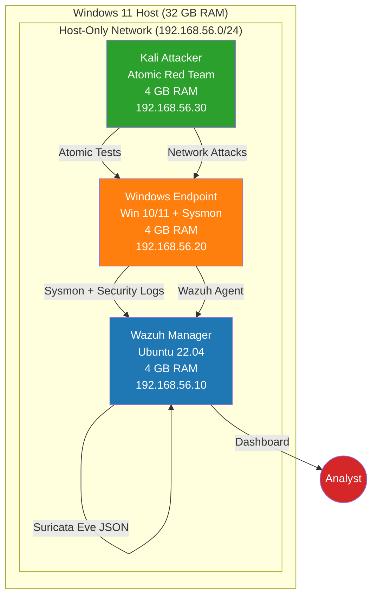

# SOC Lab Architecture

## Overview

This document describes the local SOC lab environment built for hands-on detection engineering, threat hunting, and incident investigation practice.

---

## Network Topology

```
┌─────────────────────────────────────────────────────────────────┐
│                    HOST: Windows 11 (32 GB RAM)                 │
│  ┌──────────────┐  ┌──────────────┐  ┌──────────────┐          │
│  │  Wazuh       │  │  Windows 10  │  │  Kali Linux  │          │
│  │  Manager     │  │  Endpoint    │  │  Attacker    │          │
│  │  (4 GB RAM)  │  │  (4 GB RAM)  │  │  (4 GB RAM)  │          │
│  │  Ubuntu 22.04│  │  + Sysmon    │  │  + Atomic    │          │
│  │  + Indexer   │  │  + Wazuh     │  │  Red Team    │          │
│  └──────┬───────┘  └──────┬───────┘  └──────┬───────┘          │
│         │                 │                 │                   │
│         └─────────────────┼─────────────────┘                   │
│                           ▼                                     │
│              ┌────────────────────────┐                          │
│              │   Internal Network     │                          │
│              │   (VMware Host-Only    │                          │
│              │    Network)            │                          │
│              └────────────────────────┘                          │
└─────────────────────────────────────────────────────────────────┘
```

---

## VM Specifications

### Wazuh Manager (SIEM/XDR)
| Parameter | Value |
|-----------|-------|
| **Name** | wazuh-manager |
| **OS** | Ubuntu 22.04 Server |
| **RAM** | 4 GB (4096 MB) |
| **vCPU** | 2 |
| **Disk** | 60 GB (dynamically allocated) |
| **IP** | 192.168.56.10/24 (static) |
| **Services** | Wazuh Manager 4.8+, Wazuh Indexer, Wazuh Dashboard, Filebeat, Suricata 7 |

### Windows 10/11 Endpoint
| Parameter | Value |
|-----------|-------|
| **Name** | win-endpoint |
| **OS** | Windows 10/11 Enterprise Evaluation |
| **RAM** | 4 GB (4096 MB) |
| **vCPU** | 2 |
| **Disk** | 80 GB (dynamically allocated) |
| **IP** | 192.168.56.20/24 (static) |
| **Agents** | Wazuh Agent 4.8+, Sysmon 15.x (SwiftOnSecurity config) |

### Kali Linux Attacker
| Parameter | Value |
|-----------|-------|
| **Name** | kali-attacker |
| **OS** | Kali Linux (latest) |
| **RAM** | 4 GB (4096 MB) |
| **vCPU** | 2 |
| **Disk** | 40 GB (dynamically allocated) |
| **IP** | 192.168.56.30/24 (static) |
| **Tools** | Atomic Red Team, Impacket, CrackMapExec, evil-winrm |

---

## Network Configuration

### Host-Only Network (VMware vmnet1)
```
Network: 192.168.56.0/24
Gateway: 192.168.56.1 (VMware host)
DHCP: Disabled (static IPs only)
DNS: 8.8.8.8, 1.1.1.1
```

### Firewall Rules (Wazuh Manager)
```bash
# Required ports for Wazuh agent communication
sudo ufw allow 1514/tcp   # Agent registration
sudo ufw allow 1515/tcp   # Agent enrollment
sudo ufw allow 514/udp    # Syslog forwarding
sudo ufw allow 443/tcp    # Dashboard HTTPS
sudo ufw allow 9200/tcp   # Indexer API (local only)
sudo ufw enable
```

---

## Data Flow

```
┌─────────────┐     ┌─────────────┐     ┌─────────────┐
│   Windows   │────▶│    Wazuh    │◀───│   Suricata  │
│  Endpoint   │     │   Manager   │     │   (IDS)     │
│             │     │             │     │             │
│ • Sysmon    │     │ • Indexer   │     │ • Eve JSON  │
│ • Security  │     │ • Manager   │     │ • ET Open   │
│ • PowerShell│     │ • Dashboard │     │ • Custom    │
│ • Wazuh Agt │     │ • Filebeat  │     │   Rules     │
└─────────────┘     └──────┬──────┘     └──────┬──────┘
                           │                    │
                           ▼                    ▼
                    ┌────────────────────────┐
                    │    Wazuh Dashboard     │
                    │  (https://192.168.56.10)│
                    └────────────────────────┘
```

---

## Tool Versions (Baseline)

| Tool | Version | Purpose |
|------|---------|---------|
| VMware Workstation | 17.x / Player 17.x | Hypervisor |
| Ubuntu Server | 22.04 LTS | Wazuh host OS |
| Windows | 10/11 Enterprise Eval | Target endpoint |
| Kali Linux | 2024.x | Attacker platform |
| Wazuh | 4.8+ | SIEM/XDR |
| Sysmon | 15.x | Endpoint telemetry |
| Sysmon Config | SwiftOnSecurity (latest) | Event collection policy |
| Suricata | 7.x | Network IDS |
| ET Open Ruleset | Latest | Suricata signatures |
| Atomic Red Team | Latest | Attack simulation |
| Wireshark | 4.x | PCAP analysis |
| WinPMEM | Latest | Memory acquisition |
| FTK Imager | Latest | Disk imaging |

---

## Snapshot Strategy

| Snapshot Name | When Created | Purpose |
|---------------|--------------|---------|
| `Clean Baseline` | After full setup, before any attacks | Revert to known-good state |
| `Pre-Test-T1110` | Before brute force simulation | Quick revert for re-testing |
| `Pre-Test-T1059` | Before PowerShell simulation | Quick revert for re-testing |
| `Pre-Hunt-LOLBAS` | Before LOLBAS hunt | Clean state for hunt |
| `Post-Capstone` | After full kill chain simulation | Preserve capstone evidence |

**To snapshot**: VMware → Select VM → Snapshots → Take → Name + Description
**To restore**: Select snapshot → Restore → Start VM

---

## Resource Usage (Typical)

| VM | Idle RAM | Active RAM (under load) | Disk Used |
|----|----------|------------------------|-----------|
| Wazuh Manager | ~2.5 GB | ~3.5 GB | ~25 GB |
| Windows Endpoint | ~2 GB | ~3 GB | ~40 GB |
| Kali Attacker | ~1.5 GB | ~2.5 GB | ~15 GB |
| **Total** | **~6 GB** | **~9 GB** | **~80 GB** |

**Host RAM available**: 32 GB - 9 GB = 23 GB for host OS + tools

---

## Access Points

| Service | URL / Command | Credentials |
|---------|---------------|-------------|
| Wazuh Dashboard | https://192.168.56.10 | admin / (from install script) |
| Wazuh Indexer API | https://192.168.56.10:9200 | admin / (from install script) |
| Windows RDP | 192.168.56.20:3389 | Local admin account |
| Kali SSH | ssh kali@192.168.56.30 | kali / (set during install) |
| Kali Console | VMware Console | kali / (set during install) |

---

## Maintenance Commands

### Start All VMs
```bash
# VMware Workstation CLI (vmrun)
vmrun start "wazuh-manager.vmx" nogui
vmrun start "win-endpoint.vmx" nogui
vmrun start "kali-attacker.vmx" nogui
```

### Suspend State (End of Day)
```bash
vmrun suspend "wazuh-manager.vmx" hard
vmrun suspend "win-endpoint.vmx" hard
vmrun suspend "kali-attacker.vmx" hard
```

### Check Wazuh Services
```bash
# On Wazuh Manager VM
sudo systemctl status wazuh-manager wazuh-indexer wazuh-dashboard filebeat suricata
```

### Restart Wazuh Agent (Windows)
```powershell
# PowerShell Admin on Windows VM
Restart-Service wazuh
```

---

## Diagram Source (Mermaid)



---

*Last updated: 2026-11-11 | Update when tool versions change*